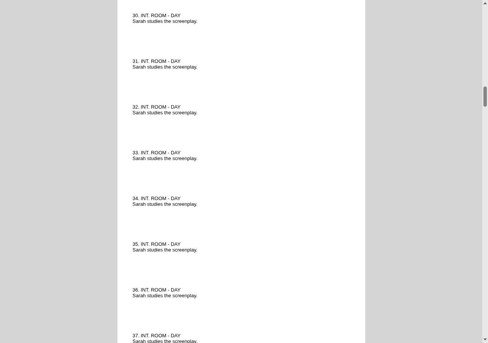
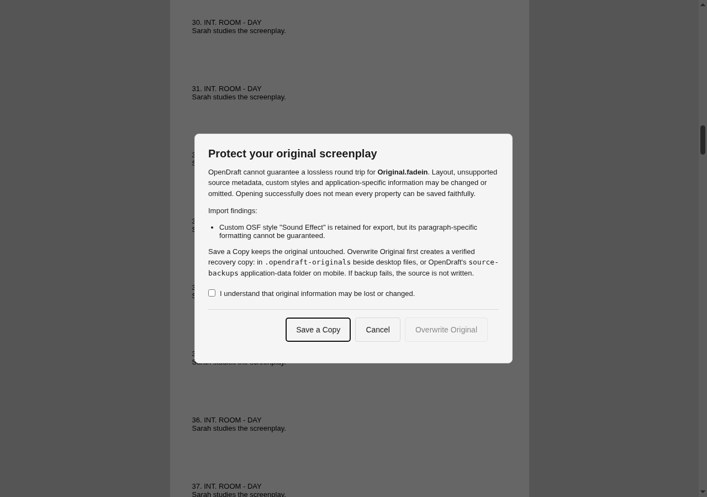

# Document layout and original-file safety

New screenplays and Page Setup → Reset to Default use US Letter (8.5 × 11 inches), with 1.5-inch left and 1-inch right, top and bottom margins. Existing documents keep their saved settings. Selecting A4 changes the paper dimensions while preserving the writer's margins. For an Australian layout, Screen Australia's guidance suggests 3.9 cm left and 2.5 cm right, top and bottom; this is regional guidance, not a universal A4 standard.

`PageLayout` retains its existing storage schema for compatibility: width, height and side margins are inches; top, bottom, header and footer margins are points. `layoutUnits.ts` provides explicit conversions. OSF dimensions are tenths of a millimetre (254 units per inch). Do not migrate existing numbers without converting their units.

OSF and Fade In import supported page dimensions, margins and inherited built-in element styles into the existing layout/template models. The imported template is embedded in `.odraft` saves, so reopening does not depend on a locally installed template. Title-page construction uses the imported geometry. Fade In export, in-place Save and linked OSF serialization share the same exporter and use document settings.

Older OpenDraft versions may discard the embedded imported template and conversion warnings when saving a working copy. Keep the original and its recovery backups independently.

Margins that leave no printable area are treated as damaged: the script still imports, on OpenDraft's default page layout, with a warning. On export, an indent that would reach into the margin is written only when the source file asked for one; otherwise it is clamped to the margin, as the editor draws it (the standard template's 7.5" right edge lies past A4's text column). Unsupported line-spacing multipliers, keep-with-next choices and source style/settings attributes are retained in source metadata where possible and reported as warnings. Custom styles may be mapped to a built-in element; their per-paragraph appearance is not guaranteed. Unsupported document sections and application-specific data can still be lost. Preserving supported measurements does not guarantee identical pagination across rendering engines. Exporting an external format does not preserve all OpenDraft metadata; use `.odraft` for a full working copy.

## Saving an original

Opening successfully never establishes lossless compatibility. The first time OpenDraft would overwrite another application's file, it asks, with the import warnings and three choices:

- **Save a Copy** opens a separate save/export operation with a different suggested name. It does not mark the original as updated. Use **Save As** to keep a full `.odraft` working copy.
- **Cancel** leaves the original unchanged.
- **Overwrite Original** requires checking an acknowledgement of potential information loss.

Replacement output is parsed before asking for consent. Desktop saves write and verify a unique temporary file beside the destination, create and verify a byte-for-byte original backup, then rename the temporary file over the destination. A failed backup or replacement aborts the save; there is no delete-original fallback. Backups are in `.opendraft-originals` beside the source (beside the real file when the path is a symlink). Copy the desired timestamped version back using the file manager. The newest five backups of each file are kept.

The question is asked once per file. After an approved overwrite the file holds OpenDraft's own output, so later saves of it neither ask nor back up again — on the desktop for as long as the file's modification time still matches OpenDraft's last save. If another application changes the file, the next save is a first overwrite again: it asks, and backs the changed file up. Exporting over an existing file does not ask a second time after the system save dialog's own replace prompt; the file is still backed up first. A file with more than one hard link is written in place, so every name keeps seeing it.

On iOS and Android, provider writes may not support atomic replacement. Before the first overwrite of another application's file, OpenDraft reads the original bytes and persists a verified copy in its `source-backups` application-data folder. **File → Recover Original File** exports those raw bytes without replacing the working document or deleting the backup. Backups are local to the device; removing app data also removes them.

Background saves never ask. Auto-save of a file opened from disk skips another application's file until the writer has approved overwriting it once, then saves it normally. In a project folder, a file OpenDraft created, or has written since the writer approved it, is saved in the background like any other; a file found in the folder that OpenDraft has only read stays pending until the writer's Save reviews it once. Which files OpenDraft last wrote is recorded per device, so a file changed elsewhere is never mistaken for OpenDraft's own output.

## Desktop file associations

OpenDraft owns `.odraft`. macOS registers other supported screenplay formats at `Alternate` rank. Both Windows NSIS and MSI advertise them through named `OpenWithProgids` entries and OpenDraft-owned classes only. Install/uninstall never writes the external extension's default value or Windows `UserChoice`. `.txt` remains importable but has no installer association. Existing user preferences are not migrated or reset.

## Validation limits

Automated tests cover repeated Letter/A4 OSF and Fade In conversions, inherited styles, source settings, saved-template restoration, linked serialization, consent/cancellation and failed original-file replacement. Browser checks exercise the real overwrite dialog and editor CSS in a multi-page harness. The save rules above were also exercised in an unsigned macOS build, on files from `test-script/pr185_fixtures.py`: cancel, first overwrite, repeated saves, a change made by another application, Save a Copy, export over the file, auto-save before and after approval, and a symlinked file. Windows/macOS installation, mobile document-provider recovery and cross-application rendering still require device testing.

## UI screenshots

These browser-harness captures use the real editor stylesheet and save-review component.

